<!--
PUBLISHING NOTES (delete before publishing)
- Medium does not render Markdown tables or LaTeX, so every table here is an image in ../images/.
- Upload each image where its ![...] line appears, and paste the italic line under it as the caption.
- Suggested Medium tags: Data Science, Machine Learning, Data Mining, Unsupervised Learning, Interpretability
-->

# Archetypal Analysis: Finding the Extremes That Explain Your Data

### A practical tour of a 30-year-old data-mining idea that keeps showing up in new places, from finch beaks to hyperspectral satellites to the insides of large vision models

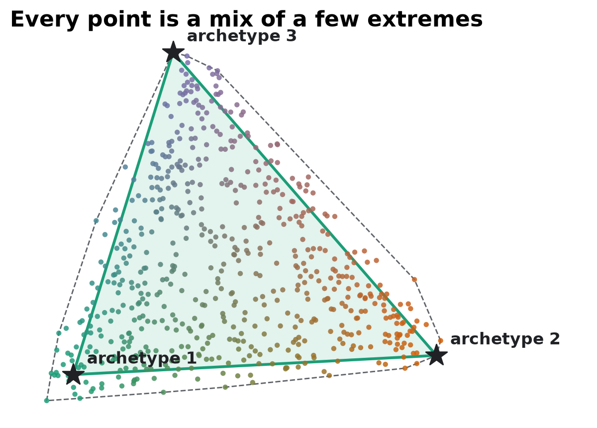
*Archetypal analysis finds a few extreme "pure types" (stars) and describes every data point as a percentage mix of them. Point colors show those mixes. (Figure by author.)*

---

Most unsupervised methods we learn in a data-mining course look for the **middle** of the data. k-means gives you centroids, which are averages. PCA gives you directions of variance through the center of the cloud. Both are useful, but neither answers a question stakeholders ask all the time:

> *"What are the distinct **kinds** of things in this data, and how much of each kind is in each record?"*

**Archetypal Analysis (AA)** answers that question. Instead of averages, it finds **archetypes**: extreme, idealized profiles that sit on the outer boundary of the data. It then describes every observation as a **mix** of those archetypes. A customer might be "70% bargain hunter, 30% brand loyalist." A handwritten digit might be "60% narrow-and-straight, 40% wide-and-curly."

This article is my walkthrough of **"A Survey on Archetypal Analysis"** by Aleix Alcacer, Irene Epifanio, Sebastian Mair and Morten Mørup (arXiv:2504.12392, v3 October 2026). The authors call it *the first survey* of AA. I add material from related survey work on clustering and matrix factorization, plus a few small experiments of my own. The focus is on intuition, architecture, metrics and ablations rather than proofs.

**TL;DR**
- AA writes each data point as a **convex combination** (non-negative weights that sum to 1) of K archetypes, and each archetype is itself a convex combination of data points.
- Archetypes land on the **boundary of the convex hull** of the data. They are *extremes*, not averages, which makes them easy to explain.
- Thirty years of extensions cover kernels, deep networks, probabilistic data, curves, robustness, coresets and more.
- The main practical problems are a **nonconvex** objective (so initialization matters), **sensitivity to outliers**, and **choosing K**.

---

## 1. The idea in one picture

Suppose your data matrix **X** has N rows (observations) and M columns (features). AA looks for two small matrices:

- **S** (N × K): row *n* holds the weights that rebuild observation *n* from the K archetypes. Weights are ≥ 0 and sum to 1.
- **C** (K × N): row *k* holds the weights that build archetype *k* from the N observations, under the same rule.

The model is simply `X ≈ S · C · X`, where `A = C · X` are the archetypes. AA chooses S and C to minimize the reconstruction error (the residual sum of squares, RSS).

The constraint on C is what makes AA special. Because archetypes must be mixtures of real observations, they can't drift off into regions where no data exists. Because S must also be a mixture, every observation is explained as a blend of those archetypes. Geometrically, AA fits a **K-cornered polytope inside the data cloud** that is as large as possible, so the data points have little distance left to "project" onto it.

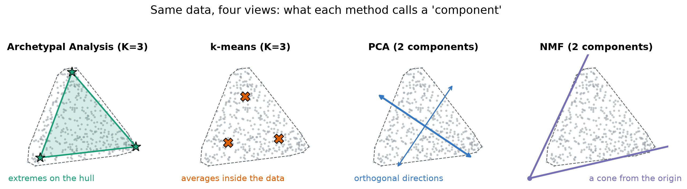
*Same 2-D data, four methods. AA's archetypes (green stars) sit at the corners. k-means centroids sit inside. PCA gives orthogonal directions. NMF opens a cone from the origin whose edges can be far from any real data. (Figure by author; idea adapted from Fig. 5 of the survey.)*

---

## 2. A short history: it started with ozone

AA was introduced by **Adele Cutler and Leo Breiman in 1994**. Yes, the Breiman of random forests and CART. The survey tells the origin story. An EPA project to simulate ozone formation used chemistry models so slow that simulating 24 hours of atmosphere took about 24 hours of compute. Researchers could only afford to run a few days, so they needed a handful of **"prototypical" days** that captured the extremes of the data. That need for extreme representatives is where archetypes came from.

The name fits. *Archetype* comes from the Greek for "first form" or "original pattern." Jung used it for universal images of a collective nature, and the survey connects it to Plato's "pure forms." Since 1994 the idea has spread widely; the survey's citation chart for the original paper reaches into the high hundreds in Google Scholar and SCOPUS.

AA also arrived at an interesting time. In the 1990s, people were frustrated that **PCA components are hard to interpret**. That frustration produced positive matrix factorization and later NMF (Lee & Seung, *Nature*, 1999). AA comes from a different angle: **convex geometry** instead of nonnegativity.

---

## 3. Three properties worth remembering

The survey's technical section is short. These three results are the ones I found most useful in practice:

1. **Archetypes live on the boundary of the convex hull** (for 1 < K < number of hull points). With K = 1 the best archetype is just the mean. With K equal to the number of hull vertices the error drops to zero.
2. **No rotational ambiguity, and invariance to shifting and scaling.** PCA, ICA and NMF can rotate or mix their factors and still fit equally well. AA's convexity constraints pin the solution down, up to reordering the archetypes, under mild conditions. Centering or rescaling the data doesn't change S or C.
3. **k-means is a stricter cousin.** If you force every row of S to be one-hot (each point uses exactly one archetype), you get k-means. So the k-means objective is an **upper bound** on the AA objective, and that fact is used to design AA initializations.

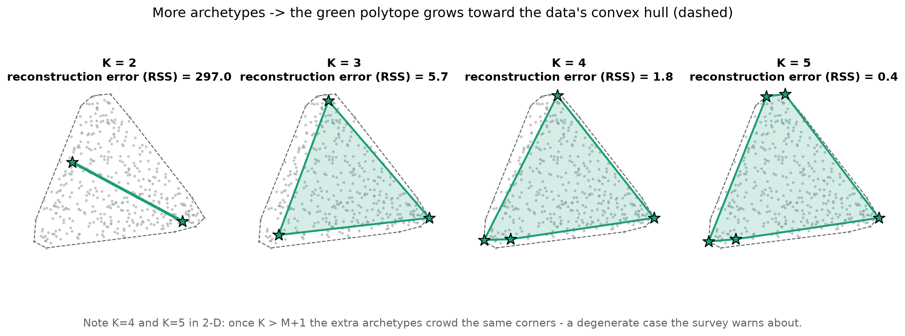
*As K grows, the archetypes (stars) spread toward the corners of the data's convex hull and the reconstruction error drops quickly. In 2-D, once K > M + 1 = 3 the extra archetypes crowd existing corners. The survey warns that the weights then stop being unique. (Figure by author.)*

That last caption shows a subtle point the survey makes well. Textbook pictures often show AA with K = 4 in two dimensions, but this is actually the **degenerate** case: any point inside the polytope can be written as a mix of several different subsets of archetypes. Real data usually has M much larger than K, so the problem rarely appears in practice. It does mean you shouldn't over-interpret toy examples.

---

## 4. Seeing it on real data: handwritten digits

The survey opens with a lovely example: AA with three archetypes on MNIST images of the digit 9 gives "narrow and straight," "narrow and sloped" and "wide and straight" nines. I reproduced the idea on the small **scikit-learn digits** dataset (8×8 images) using the digit **2**, and compared AA with k-means, PCA and NMF using the same number of components.

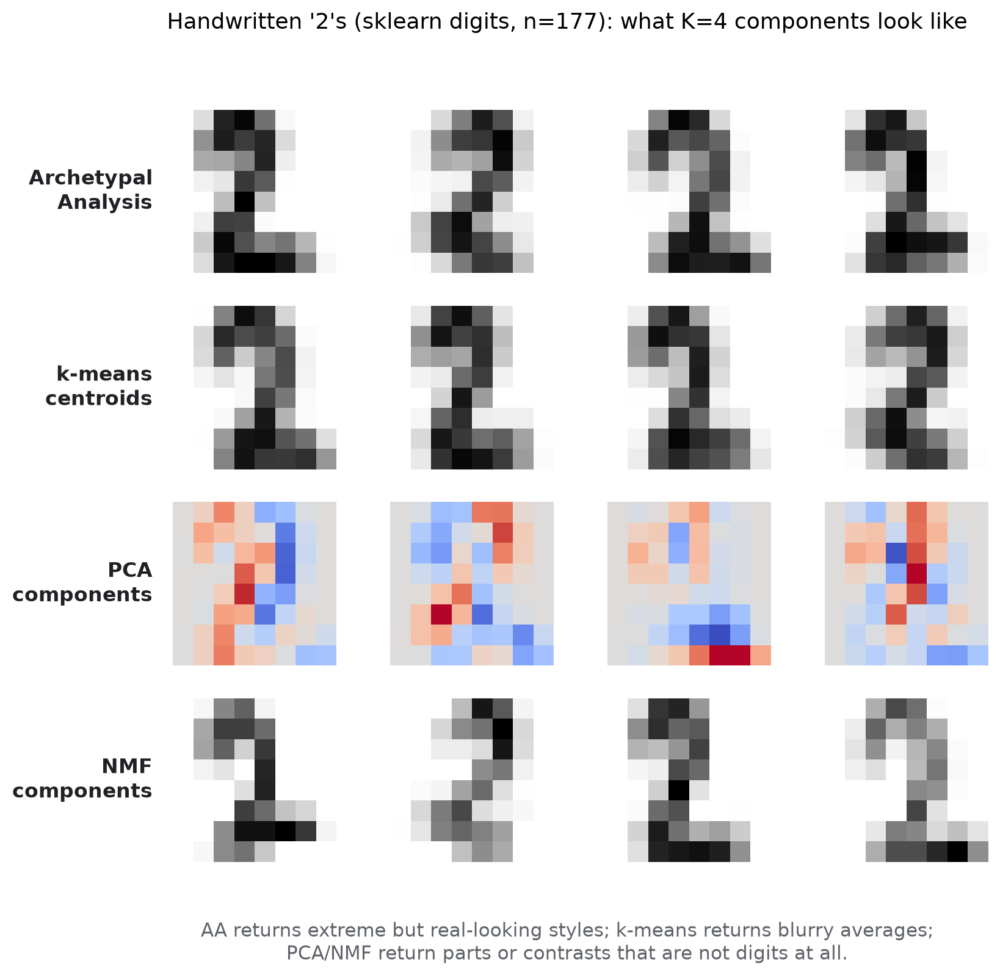
*Four components per method on 177 handwritten 2s. AA's archetypes look like real, slightly exaggerated 2s (tall and narrow, wide with a long base, and so on). k-means centroids are blurrier averages. PCA components are positive/negative contrast maps. NMF components are partial strokes. (Figure by author.)*

The real payoff is in the weights. With K = 3, every observation's weight vector lies on a triangle (a 2-simplex), so you can **plot the whole dataset as a mix of archetypes**:

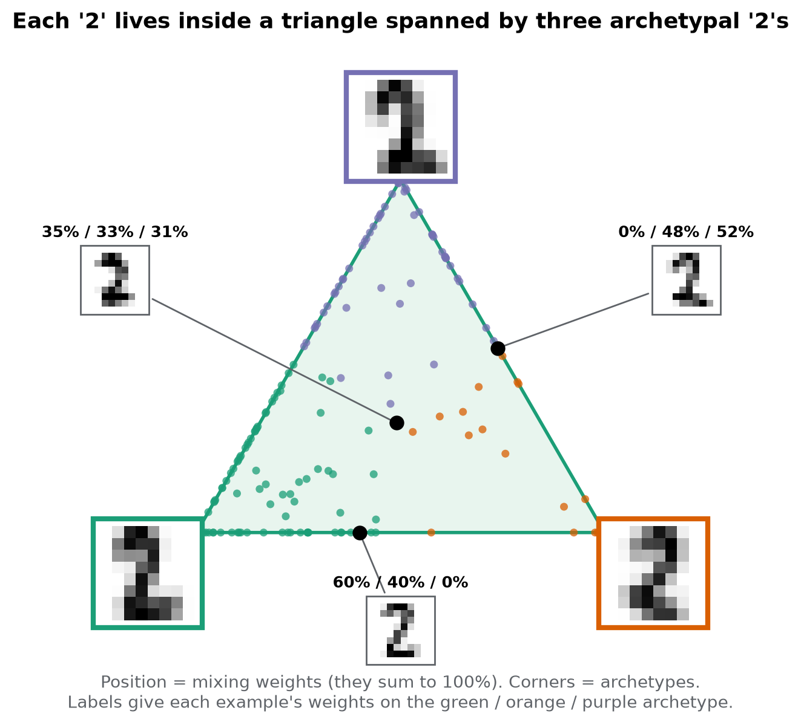
*Each dot is one handwritten 2, placed by its mixing weights. The corners are the three archetypal 2s. The labeled examples show how a 2 can be read as, say, "60% archetype A + 40% archetype B." Many points sit on the edges, which means they need only two archetypes. (Figure by author.)*

This is the kind of chart you can show a non-technical audience, and I think it is AA's biggest selling point.

---

## 5. AA vs. the usual suspects

AA fits naturally into the toolbox we cover in CMPE 255, alongside clustering and matrix factorization. Here's my summary, combining the survey's Table I with the classic clustering and NMF survey literature (Jain, 2010; Wang & Zhang, 2013; Gillis, 2014):

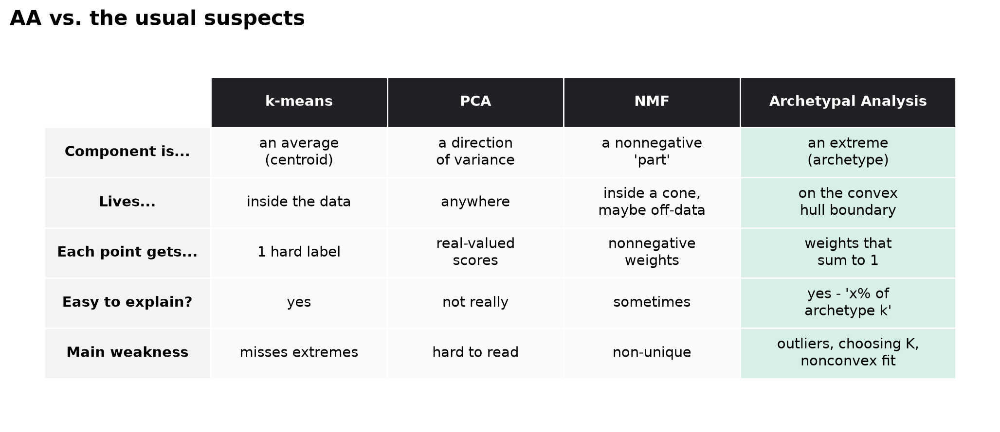
*How AA compares with k-means, PCA and NMF. (Figure by author.)*

A useful mental model from the survey: **clustering finds typical representatives, while AA finds extreme ones.** They are complementary rather than competing. There is even a clustering method, *k-maxoids*, that moves cluster representatives to the boundary, the same way AA moves them to the hull. And **archetypoid analysis** relates to AA the way k-medoids relates to k-means: the archetypes must be actual data points.

AA is also closely related to **hyperspectral unmixing** in remote sensing (see Bioucas-Dias et al., 2012). There, each pixel's spectrum is modeled as a convex mix of a few pure material spectra called *endmembers*. Classic unmixing methods fit a minimum-volume simplex *around* the data from outside. AA fits a polytope *inside* the data's hull.

---

## 6. The AA family tree (the "architecture" section)

The survey organizes three decades of extensions. I condensed its Table II into one diagram:

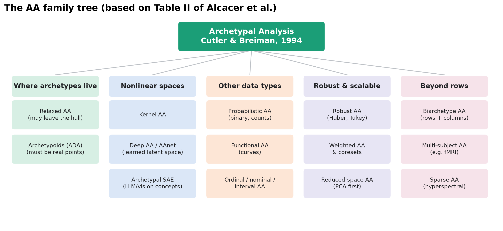
*Main branches of AA research. (Figure by author, based on Table II of Alcacer et al.)*

The branches I found most interesting:

- **Relaxed AA and archetypoids.** Relaxed AA lets the C weights sum to "about 1" (between 1 − δ and 1 + δ), so archetypes may sit slightly *outside* the hull when the true pure forms were never observed. **Archetypoid analysis (ADA)** goes the other way and forces archetypes to be *real observations*. That turns the problem into a combinatorial search, but you can hand a domain expert an actual case to inspect.
- **Kernel AA.** The AA objective can be written entirely in terms of the Gram matrix X·Xᵀ. Swap in any kernel and you get AA in a nonlinear feature space, even for data that only comes as pairwise similarities, such as graphs or sequences. The catch is that the kernel archetype has no *pre-image*, so you can't plot it in input space unless you also restrict it to real observations (kernel archetypoids).
- **Deep AA.** AAnet (van Dijk et al., 2019) and DeepAA (Keller et al., *IJCV* 2021) learn a neural embedding in which the data form a simplex. The survey raises a sharp point here: if the encoder is flexible enough, it can push almost *any* points to the corners. So which points become archetypes depends on the network and any side information, and these methods are "semi-supervised in substance."
- **Archetypal SAEs.** This was the most surprising connection for me. Fel et al. (ICML 2025) constrain the dictionary atoms of **sparse autoencoders**, the tool used to find concepts inside large vision models, to lie in the convex hull of the data. The motivation is *stability*: unconstrained SAE dictionaries change a lot between random seeds. With more than 10⁸ samples they can't optimize C directly, so they first shrink the data with k-means. AA ideas are now showing up in modern interpretability research.
- **Other data types.** Probabilistic AA (Seth & Eugster, 2016) handles binary, count and multinomial data. Other variants cover ordinal and nominal answers (think survey questionnaires), functional data (curves), intervals and histograms, shapes, and networks.
- **Robust, weighted and scalable AA.** Huber and Tukey losses reduce the influence of outliers. Weighted AA lets observations count differently, and that is exactly what you need to run AA on a **coreset**, a small weighted sample with provable error guarantees (Mair & Brefeld, *NeurIPS* 2019).
- **Beyond rows.** Biarchetype analysis (Alcacer et al., *TPAMI* 2024) finds archetypes of observations *and* of features at the same time. It relates to AA the way biclustering relates to clustering. Multi-subject AA shares archetypes across people in fMRI studies.

---

## 7. Under the hood: how AA is fitted

The objective is **nonconvex** in (S, C) jointly, but convex in each one when the other is held fixed. Almost every solver therefore alternates: update S, update C, repeat. The survey's Table III compares nine solvers. My cheat-sheet version:

- **NNLS / quadratic programming** (Cutler & Breiman, 1994): solves each subproblem exactly, but the cost grows with K³. Good for small problems.
- **Active-set** methods: fast when the weights are very sparse.
- **PCHA (projected gradient)** (Mørup & Hansen, 2012), **Frank–Wolfe** and **block coordinate descent**: each iteration costs O(N·M·K), so these are the sensible defaults for large data. They need more iterations. The survey recommends PCHA with line search as a robust general-purpose choice.
- **Softmax + Adam**: use when AA is one piece of a larger differentiable model or you want GPU training.
- **Archetypoid selection (BUILD–SWAP)**: only when archetypes must be real observations.

To shrink the problem: run PCA first (**reduced-space AA**), compute AA on the convex-hull "frame" only, or use **coresets**. A neat trick is to drop, at each iteration, the points already inside the current archetype polytope, since they contribute no error. The survey notes this stops working well in high dimensions.

My figures use a small NumPy implementation (included in the GitHub repo) that alternates accelerated projected-gradient steps onto the simplex for S and C. It is in the PCHA family, so each step costs O(N·M·K).

---

## 8. Ablations and metrics: what actually matters in practice

The survey is more practical than most I've read. It has whole sections on **initialization**, **robustness checks** and **choosing K**. I ran small experiments on all three.

### 8.1 Initialization

Because the objective is nonconvex, where you start matters. The survey compares:

- **Uniform**: pick K random data points (the original 1994 proposal).
- **FurthestSum**: after a random first pick, repeatedly choose the point with the largest *summed* distance to the archetypes chosen so far. This tends to pick hull points.
- **AA++** (Mair & Sjölund, *TMLR* 2024): like k-means++, but the next point is sampled with probability proportional to its squared distance to the *convex hull* of the chosen archetypes.

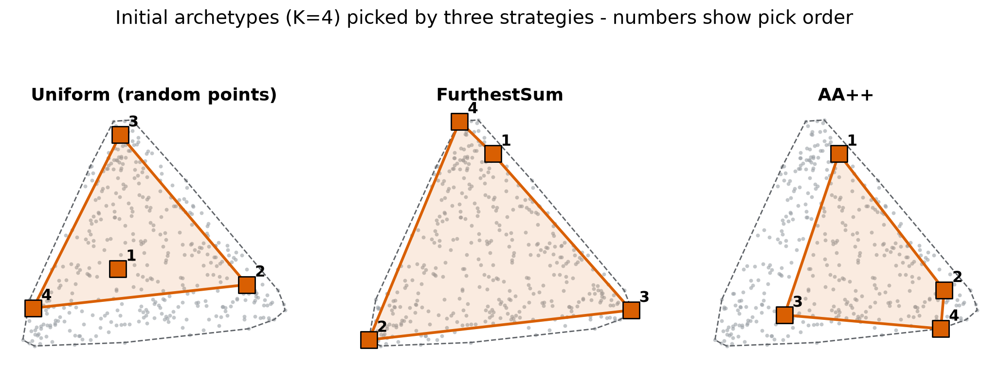
*Initial archetypes picked by each strategy (K = 4). Uniform can choose a point in the middle of the data, which is a wasted archetype. FurthestSum jumps straight to the extremes. AA++ is in between, choosing far-away points at random rather than deterministically. (Figure by author.)*

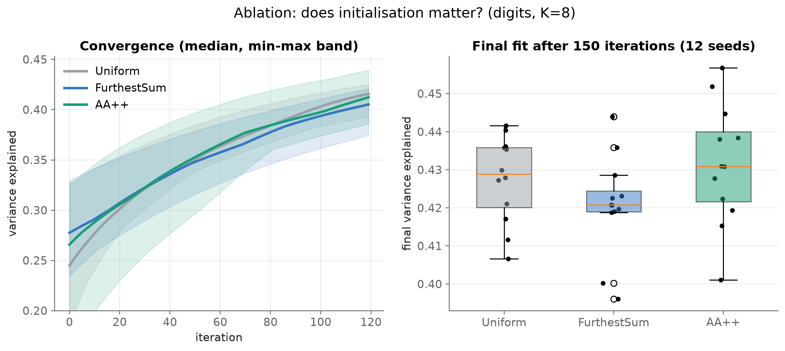
*Ablation on the full digits dataset (N = 1797, M = 64, K = 8, 12 random seeds per method). Left: convergence. Right: final fit after 150 iterations. (Figure by author.)*

**What I found:** FurthestSum gives the best *starting* point: about 28% variance explained at iteration 0, versus about 25% for Uniform. After 150 iterations, though, the three methods ended up statistically tied: mean final variance explained was 0.428 (Uniform), 0.421 (FurthestSum) and 0.431 (AA++), with a standard deviation of about 0.01–0.015 per method. AA++ had the best single run and the best average, but also the widest spread. FurthestSum was the most consistent apart from a couple of bad seeds.

Two caveats. First, the curves were still rising at 150 iterations, so this compares methods *on a fixed budget*, not at convergence. Second, the AA++ paper reports clearer gains on larger benchmarks. My takeaway is that **initialization changes where you start, but random restarts still matter at least as much**. Running AA once is never enough.

### 8.2 Choosing K and checking that the answer is stable

There is no single correct way to choose K. Common tools are elbow or scree plots of RSS or variance explained, BIC-style criteria, and an AIC-like criterion designed specifically for AA (Suleman, 2017). The survey adds something I hadn't seen before: two **reproducibility metrics** computed across random restarts.

- **NMI(S, S′)**: normalized mutual information between two runs' weight matrices. Do points get the same mixtures?
- **sim(A, A′)**: one minus the mean squared distance between matched archetypes, divided by the total data variance. Do the archetypes themselves move?

The survey's application figures (finches, NMR spectra, a hyperspectral image of Indiana farmland, U.S. congressional votes) all choose K by looking at variance explained *and* these stability scores together. For example, the hyperspectral image supports up to K = 6 before solutions become unreliable. I applied the same recipe to the digits:

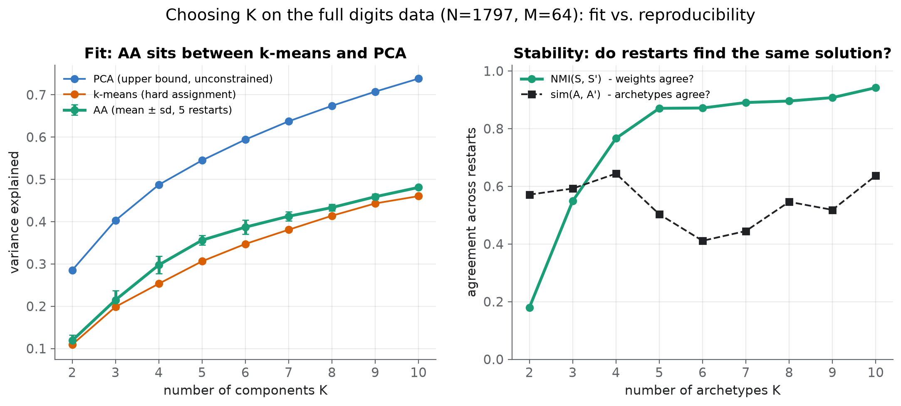
*Left: variance explained for AA (mean ± sd over 5 restarts), compared with PCA (the unconstrained upper bound) and k-means. Right: agreement between restarts. (Figure by author.)*

**What I found:**
- **AA's fit falls between k-means and PCA, close to k-means.** That makes sense: AA is k-means with soft, convex memberships, while PCA has no constraints at all. At K = 10, AA explains 48% of the variance, k-means 46% and PCA 74%. You give up a lot of reconstruction accuracy in exchange for components you can explain.
- **The variance curve has no clear elbow.** The digits contain ten classes and a lot of within-class variation, so variance explained alone doesn't pick K.
- **The stability metrics disagree with each other in an informative way.** NMI between weight matrices rises steadily with K, from 0.18 at K = 2 to above 0.85 from K = 5 on. Archetype similarity peaks at K = 4 (0.64), dips at K = 6–7 (around 0.41–0.45), and recovers at K = 10. In other words, different runs often *reconstruct points the same way while placing the archetypes differently*. That is exactly the non-uniqueness the survey warns about, and it is why it recommends checking **both** S and A.

If I had to choose for this dataset, K = 4 is the most reproducible small model and K = 10 is the most reproducible large one. In a real project, a domain expert would decide between them.

---

## 9. Where AA is used

The survey's application section reads like a tour of science:

- **Biology and medicine.** The most principled use comes from Pareto theory. If organisms must trade off several tasks, optimal phenotypes fill a polytope whose corners are task specialists (Shoval et al., *Science* 2012; Hart et al., *Nature Methods* 2015). AA finds those corners. It is also used for single-cell RNA-seq cell states, population genetics, transplant biopsies, visual-field loss, COVID-19 outbreak patterns, and body shapes for ergonomic design.
- **Physics and chemistry.** Galaxy spectra and NMR spectra are naturally mixtures of pure sources. In the survey's NMR example, AA with K = 3 recovers the three alcohols (propanol, butanol, pentanol) *and* their concentrations.
- **Climate and remote sensing.** Precipitation patterns, and hyperspectral unmixing, where archetypes are pure material spectra.
- **Computer and data science.** Anomaly detection: projecting into "archetype space" helped k-NN catch an outlier that other detectors missed in the survey's example. Also topic-model-like text analysis, video summarization, archetypal **player styles in video games**, and fashion recommenders.
- **Social science and business.** Personality types, benchmarking, market segmentation, sports-player profiles and student profiles. Archetypoids are especially popular here because a "real" representative is easier to sell than an idealized one.

<!-- OPTIONAL: insert one of the survey's application figures here (e.g. Fig. 11 NMR or Fig. 12 hyperspectral) with the caption "Source: Alcacer et al., A Survey on Archetypal Analysis (2026), Fig. X." -->

---

## 10. Limitations: read before you use it

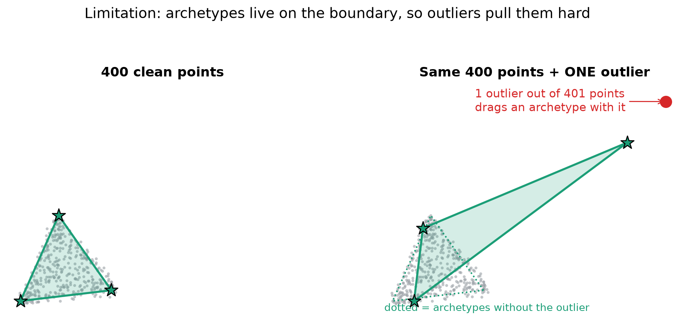
*One far-away point out of 401 pulls an archetype (and the whole polytope) away from the real data. A point that is only moderately far away just tilts the solution. (Figure by author.)*

The survey is upfront about the downsides:

1. **Nonconvex optimization.** Different starts give different answers. Use good initialization (FurthestSum or AA++) *and* several restarts, and report how much the loss varies.
2. **Outliers.** Archetypes are boundary points by design, so a single extreme point can capture one, as the figure shows. Clean the data first or use robust AA.
3. **Choosing K.** There is no universally accepted criterion. Too few archetypes underfit; too many become redundant and hard to interpret.
4. **Scalability.** Vanilla AA involves large matrix products and repeated projections. Coresets, PCA-first AA and randomized methods help, at some cost in accuracy.
5. **Degeneracy.** When K exceeds the data's intrinsic dimension plus one, different runs can produce equally good but different solutions.
6. **Pure forms may not exist in the data.** AA assumes the extremes are (mixtures of) observed points. If no pure sample was ever measured, you need relaxed AA or volume-based methods.

---

## 11. Open problems the survey highlights

- **Time-varying archetypes**: polytopes that evolve smoothly, borrowing ideas from dynamical systems.
- **AA on manifolds**: real data rarely lie in a flat polytope. Kernel and deep AA are partial answers, and combining AA with manifold learning is still open.
- **Automatic K** and **transfer between model orders**: adding or removing an archetype without refitting from scratch.
- **Fair AA** and **differentially private AA**.
- **Convex relaxations** of AA, similar to spectral relaxations for clustering, to escape local minima.

---

## 12. My two cents

**What the survey does well.**
- **It fills a real gap.** Before it, newcomers had to piece AA together from statistics, chemometrics, remote sensing and ML papers. The only earlier review was a short one in Portuguese.
- **It is practical.** The "practical guidance" paragraph on choosing a solver, the initialization comparison, and especially the **NMI/sim reproducibility checks** are things I'll reuse for any matrix factorization, not just AA.
- **It is honest about deep AA.** The point that a flexible encoder can make *anything* an archetype is a useful warning, and it applies to many "interpretable latent space" papers.

**What I wish it had.**
- **A shared benchmark.** The tables compare variants by *what they are* (where archetypes live, which data types they handle) and solvers by big-O cost. There are no head-to-head numbers on common datasets. A benchmark suite with runtime, RSS and stability scores for each solver and variant would make the solver advice far more convincing.
- **More on evaluation beyond reconstruction.** Interpretability is AA's main promise, yet there is little discussion of how to *measure* whether archetypes help people, for example through user studies.
- **A decision flowchart.** The guidance is all there, but spread across sections. A one-page "Should I use AA, ADA, kernel AA or plain k-means?" chart would help practitioners a lot.

**When I would reach for AA.** If the business question is *"what are the extremes or pure types, and how close is each record to them?"* (customer personas, athlete profiles, material spectra, trade-offs between competing goals), AA is a better fit than k-means and much easier to explain than PCA. If the question is *"what are the typical groups?"*, I'd still start with clustering. In either case I'd run AA with FurthestSum or AA++, at least 5–10 restarts, and the stability metrics above before trusting any single archetype.

---

## Try it yourself

- **Python:** `archetypes` (scikit-learn-style API, from the survey's first author), `py_pcha`.
- **R:** `archetypes` (Eugster & Leisch, 2009) and `adamethods` for archetypoids.
- **My code:** every figure in this article is reproducible from the companion GitHub repo: https://github.com/anita-agasaveeran/Assignment5

---

## References

**Main paper**
- A. Alcacer, I. Epifanio, S. Mair, M. Mørup. *A Survey on Archetypal Analysis.* arXiv:2504.12392v3, 2026.

**Archetypal analysis**
- A. Cutler, L. Breiman. *Archetypal Analysis.* Technometrics 36(4), 1994.
- M. Mørup, L. K. Hansen. *Archetypal analysis for machine learning and data mining.* Neurocomputing 80, 2012.
- G. Vinué, I. Epifanio, S. Alemany. *Archetypoids: A new approach to define representative archetypal data.* CSDA 87, 2015.
- S. Seth, M. J. A. Eugster. *Probabilistic archetypal analysis.* Machine Learning 102, 2016.
- S. Mair, U. Brefeld. *Coresets for archetypal analysis.* NeurIPS 2019.
- S. Mair, J. Sjölund. *Archetypal analysis++: Rethinking the initialization strategy.* TMLR 2024.
- D. van Dijk et al. *Finding archetypal spaces using neural networks.* IEEE Big Data 2019.
- S. M. Keller et al. *Learning extremal representations with deep archetypal analysis.* IJCV 129, 2021.
- T. Fel et al. *Archetypal SAE: Adaptive and stable dictionary learning for concept extraction in large vision models.* ICML 2025.
- A. Alcacer, I. Epifanio, X. Gual-Arnau. *Biarchetype analysis.* IEEE TPAMI 46(12), 2024.
- M. J. A. Eugster, F. Leisch. *From Spider-Man to Hero: Archetypal analysis in R.* JSS 30(8), 2009.

**Related surveys and background**
- A. K. Jain. *Data clustering: 50 years beyond K-means.* Pattern Recognition Letters 31(8), 2010.
- Y.-X. Wang, Y.-J. Zhang. *Nonnegative Matrix Factorization: A Comprehensive Review.* IEEE TKDE 25(6), 2013.
- N. Gillis. *The Why and How of Nonnegative Matrix Factorization.* arXiv:1401.5226, 2014.
- J. M. Bioucas-Dias et al. *Hyperspectral unmixing overview: Geometrical, statistical, and sparse regression-based approaches.* IEEE JSTARS 5(2), 2012.
- D. D. Lee, H. S. Seung. *Learning the parts of objects by non-negative matrix factorization.* Nature 401, 1999.
- O. Shoval et al. *Evolutionary trade-offs, Pareto optimality, and the geometry of phenotype space.* Science 336, 2012.
- Y. Hart et al. *Inferring biological tasks using Pareto analysis of high-dimensional data.* Nature Methods 12, 2015.

*Written for CMPE 255 (Data Mining), San José State University, Fall 2026. All figures are by the author unless otherwise credited.*
